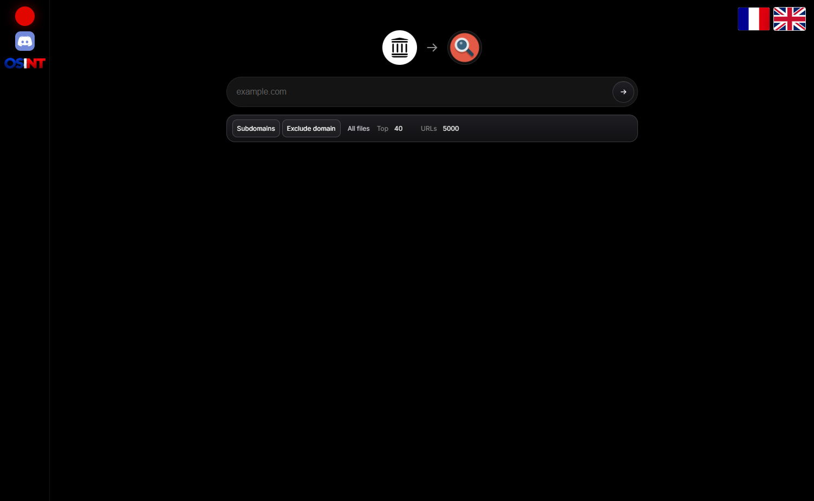

# Wayback Pivot

<p align="center">
  
</p>

English first. A shorter French section is below.

## English

**Wayback Pivot** reads filenames the Wayback Machine stored for a domain and turns them into [urlscan.io](https://urlscan.io) dorks. Use it when the domain has no scans on urlscan.io yet. Unique filenames, and the SHA256 of the archived file, show other hosts that requested the same resource.

```
Wayback  cible.com/static/app.8f3a1c.js
            │
            ▼
filename:"app.8f3a1c.js" AND NOT page.domain:cible.com
hash:<sha256> AND NOT page.domain:cible.com
            │
            ▼
urlscan.io  → other domains, IPs, ASNs
```

The tool does not scan the target and does not send anything to urlscan.io. It only reads the public CDX index, then opens search links in your browser.

### Features

- CDX crawl of `*.domain` or one host, with resume keys and a delay between pages
- Filename extraction, generic names dropped (`index.html`, `jquery.min.js`, `robots.txt`, …)
- Build hashes ranked first (`main.a1b2c3d4.js`, `chunk-abc123.js`)
- `filename:"…" AND NOT page.domain:` dork, reserved characters escaped
- SHA256 of the Wayback capture and a `hash:` dork. urlscan.io pivots on SHA256, not the CDX SHA1
- Local web UI, French and English, dark layout
- CLI output as text, JSON, or CSV

### Example

```
filename:"app.8f3a1c9e.js" AND NOT page.domain:exemple.com
hash:9f3a1c9e0b… AND NOT page.domain:exemple.com
```

`filename` is the public urlscan.io field: any URL requested during a scan. `files.filename` and `files.sha256` exist on paid plans (`--field files.filename`). Public search mostly covers recent scans. A urlscan.io account extends history.

### Requirements

- Python 3.9+
- Standard library only. No `pip install`.

### Install

```bash
git clone https://github.com/redsecurityfr/-WaybackPivot.git
cd -WaybackPivot
```

### Usage

```bash
# Local UI → http://127.0.0.1:8765
python web.py

# Interactive prompt
python wayback_pivot.py

# Direct pivot
python wayback_pivot.py exemple.com
python wayback_pivot.py exemple.com --top 40 --limit 5000
python wayback_pivot.py app.exemple.com --match host
python wayback_pivot.py exemple.com --from 20200101 --to 20241231
python wayback_pivot.py exemple.com --all --keep-domain

# Export
python wayback_pivot.py exemple.com --format json > pivots.json
python wayback_pivot.py exemple.com --format csv > pivots.csv
```

### Options

| Option | Description |
|--------|-------------|
| `domain` | Domain to read from the Wayback Machine. Prompted if omitted |
| `--match domain` | Include subdomains, `*.domain` (default) |
| `--match host` | That host only |
| `--limit` | Max CDX URLs (default 20000) |
| `--page-size` | CDX page size (default 5000) |
| `--status` | HTTP status filter, default `200`. Empty string keeps every status |
| `--from` / `--to` | Date window, `YYYYMMDD` |
| `--all` | Keep every filename, not only useful extensions |
| `--min-len` | Minimum filename length (default 6) |
| `--top` | How many dorks to print (default 100). The UI uses 40 |
| `--samples` | Wayback sample URLs per file (default 2) |
| `--field` | urlscan.io field, default `filename` |
| `--keep-domain` | Do not add `AND NOT page.domain:` |
| `--format` | `text`, `json`, or `csv` |
| `--delay` | Seconds between CDX pages (default 1) |
| `--timeout` | HTTP timeout in seconds (default 60) |

### Limits

The CDX API is public and sometimes slow. A common name such as `logo.png` or `app.js` matches unrelated sites. The score favors long names and build hashes. Read the hits before you treat them as related infrastructure.

SHA256 is computed from the latest Wayback capture, up to 1.5 MB. A capture that is missing or too large is reported as unavailable.

## Français

**Wayback Pivot** lit les noms de fichiers d’un domaine dans la Wayback Machine et en fait des dorks urlscan.io, plus le SHA256 de la capture. Pratique quand le domaine n’est pas encore sur urlscan.io.

Python 3.9+, aucune dépendance.

```bash
git clone https://github.com/redsecurityfr/-WaybackPivot.git
cd -WaybackPivot
python web.py
python wayback_pivot.py exemple.com --top 40
python wayback_pivot.py exemple.com --format json > pivots.json
```

| Option | Description |
|--------|-------------|
| `--match domain` / `host` | Sous-domaines, ou cet hôte seulement |
| `--limit` / `--top` | Plafond d’URL CDX, puis nombre de dorks |
| `--from` / `--to` | Fenêtre `AAAAMMJJ` |
| `--all` | Tous les noms de fichiers |
| `--keep-domain` | Ne pas exclure le domaine source |
| `--format` | `text`, `json` ou `csv` |

L’interface locale est sur `http://127.0.0.1:8765`, en français ou en anglais.

## Author

[@RosoOSINT](https://x.com/RosoOSINT) - [roso.info](https://roso.info) - [osint.paris](https://osint.paris/)

## Community

OSINT Discord: [https://discord.com/invite/rPkY5jaTfF](https://discord.com/invite/rPkY5jaTfF)
